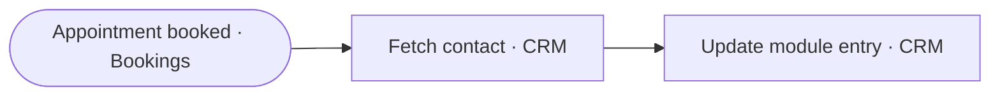

# Kickoff Booked Sync

> When a kickoff is booked, the CRM contact is fetched and the booking is written back, so the calendar and the CRM always agree.

**Live case study:** [https://mnkiswan.github.io/kickoff-booked-sync/](https://mnkiswan.github.io/kickoff-booked-sync/) · **Portfolio:** [zoho-flow-portfolio](https://mnkiswan.github.io/zoho-flow-portfolio/)

**Trigger:** An appointment is booked in Zoho Bookings  
**Zoho apps:** Zoho Bookings, Zoho CRM

## Flow

## Steps

1. **A kickoff is booked** (Zoho Bookings): The booking carries the appointment details into the flow.
2. **Fetch the matching contact** (Zoho CRM): The contact is looked up in the CRM so the booking lands on the right person.
3. **Update the CRM record** (Zoho CRM): The module entry is updated with the booking, so the record shows the real kickoff date.

## The problem

A kickoff could be booked while the CRM still showed the old status. The team lost track of when clients were meeting.

## Business impact

- **Calendar ↔ CRM**: The CRM shows the kickoff date without anyone checking the calendar.
- **Manual logging**: Nobody copies booking details into the CRM.
- **Before the call**: The record is up to date before the kickoff starts.

---
Part of the [Zoho Flow portfolio](https://github.com/mnkiswan/zoho-flow-portfolio).
